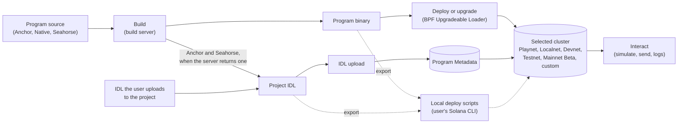
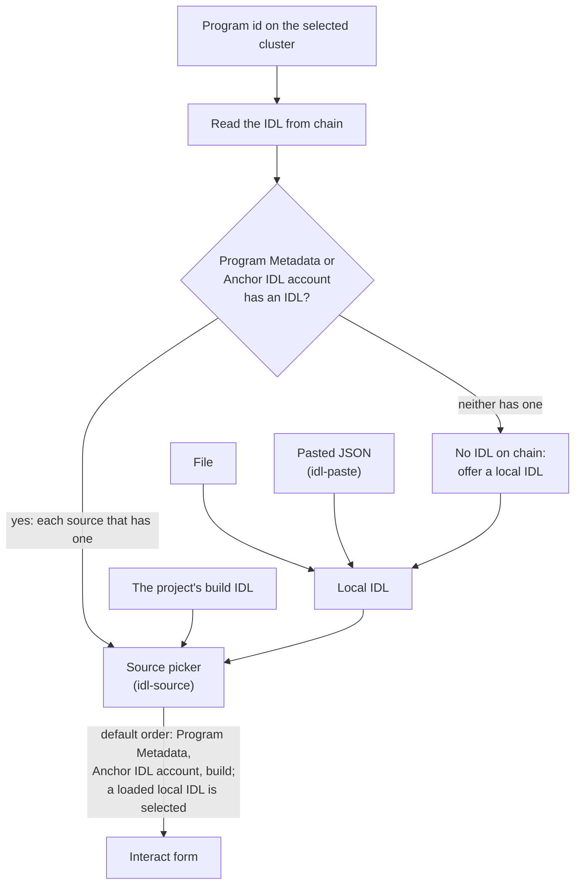
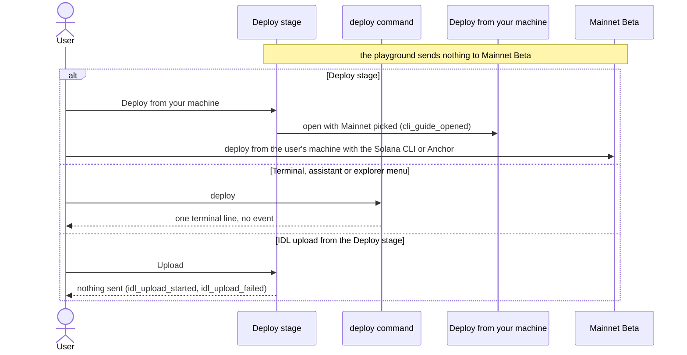

# Design

## Context

See [proposal.md](proposal.md), "Why". What client-v2 does in each step, read
at `dc22a4740`:

- **Build**: `commands/build/build.ts` writes the program keypair's public key
  into `declare_id!` and posts the source to the build server
  (`utils/server.ts`). The server returns `{ stderr, uuid, idl }`, keeps the
  binary and serves it to the deploy from `/deploy/{uuid}`.
  `utils/program-info.ts` keeps the IDL, the keypair and the uuid in
  `.workspace/program-info.json`, which project sync carries to other
  devices. At that commit Anchor is pinned to 0.29; after the
  `stable-anchor-1-1-2` change the stable build server builds with Anchor
  1.1.2 and returns no IDL, and the `build` command then leaves the
  project's IDL as it was, as the requirement "A build without an IDL keeps
  the IDL the browser holds" of that change describes.
- **Deploy**: `commands/deploy/` runs the BPF Upgradeable Loader steps in the
  browser. The playground wallet (`utils/wallet/wallet.ts`, a keypair in
  localStorage) pays and signs. An extension wallet first transfers the cost
  to the playground wallet. Nothing warns before Mainnet Beta.
- **IDL**: nothing writes an IDL on chain from the UI. "Upload IDL" in
  `views/flow/stages/IdlActions.tsx` replaces the IDL in the browser only.
  `effects/fetch-idl/fetch-idl.ts` reads the Anchor IDL account, and only for
  the project's own deployed program.
- **Interact**: `views/flow/stages/Interact.tsx` embeds the upstream test form
  (`views/sidebar/test/`) over `utils/program-interaction/`. Accounts with a
  `pda` field get a From seed generator, and `pda.programId` is ignored.
- **Export**: `PgFramework.exportWorkspace` (`utils/framework.ts`) zips the
  framework layout with `target/deploy/<name>-keypair.json` and a README of
  `anchor build` and `anchor test`.

Solana Explorer's Interactive IDL (`app/features/idl/interactive-idl/` in
solana-explorer) is the reference for Interact. It reads Codama and Anchor
0.30+ only, takes the IDL from chain only (Program Metadata first, the Anchor
IDL account as a fallback), derives PDAs from IDL seeds, simulates before an
execute by default, and confirms the first execute on mainnet.

## Goals / Non-Goals

**Goals:**

- Every function in the four specs exists in client-v2, and the existing ones
  keep working while the gaps are filled.
- The flow on the playground matches the flow on a developer's machine:
  `anchor build`, `solana program deploy`, an IDL upload, a client call.

**Non-Goals:**

- Replacing the upstream test form in one step. It moves by the UI move rule
  in `client-v2/CLAUDE.md`, one part at a time.
- Changing the build server's API.

## Decisions

### Two outputs, one cluster per upload

A project has two outputs from the same source: the program binary, which a
build produces, and the IDL, which the build keeps when the build server
returns one and which the user uploads to the project otherwise. A deploy
puts each on one cluster, in separate transactions: first the binary, then
the IDL. The specs therefore track deploy and IDL state per cluster: a
program on Devnet is not on Mainnet Beta until it is uploaded there. This
mirrors how Solana itself works, and keeps the user from reading a Devnet IDL
as proof of a mainnet program.

### Program Metadata is the default IDL source, the Anchor IDL account is legacy

Both store an IDL for a program id, and the Explorer shows both. Program
Metadata is the program the ecosystem is moving to and the one the Explorer
reads first, so the playground uploads there and reads it first. The Anchor
IDL account stays available for reading, because programs deployed with
older Anchor tooling publish only there. The playground does not upload to
the Anchor IDL account: an upload calls `uploadProjectIdl` of the
`program-idl` slice, and the design of the `terminal-anchor-idl` change
gives the reason under "The upload writes the canonical Program Metadata
account".
Alternative considered: Anchor IDL account only, as the `anchor idl init` of
Anchor 0.29's CLI does; the one of Anchor 1.1.2's CLI writes Program
Metadata. Rejected: an IDL there is not what the Explorer reads first, so a
user could publish and still see a stale IDL.

### A local IDL is a first-class source

A program may be deployed with no IDL published, often because other people
maintain it. The playground does not build an IDL for such a program. Instead
the user supplies one: a file, or JSON pasted or typed into an editor. Both
paths give the same result. A local IDL is also how the user tries an edited
copy of a published IDL. Loading one never writes to the chain.

### The playground does not deploy to mainnet

The playground wallet is a keypair in localStorage. Funding it for a mainnet
deploy means sending real SOL to a key any script on the page can read. The
playground cannot make that safe, so it does not deploy to Mainnet Beta and
sends the user to the alternative: the same program, with the same program
id, deployed from the user's machine.

The refusal is the one the main spec `mainnet-deploy-warning` describes, and
this change adds no dialog to it. The requirement "Deploys to mainnet are
refused" puts the refusal in the `deploy` command itself, not in front of one
button, so the terminal, the assistant's tools, and the explorer menu reach
it too: the command prints one terminal line and sends nothing. The
requirement "The Deploy stage points mainnet to the user's machine" gives
the stage its line, no deploy action, and the pill "Deploy from your
machine", which opens the dialog of that name with Mainnet picked. An
extension wallet does not lift the refusal, because a deploy with an
extension still moves the cost into the playground wallet, which signs the
loader transactions.

A refused deploy is not a deploy attempt, so it sends no `deploy_started`
and no outcome event. The pill's press sends `cli_guide_opened`, which the
requirement "CLI deploy events" of `cli-deploy` describes. An IDL upload
from the Deploy stage follows the rule of the terminal's `anchor idl init`:
nothing is sent, and the attempt is recorded with `idl_upload_started` and
then `idl_upload_failed`, as the requirements "An IDL upload sends its
events" and "A failed upload names its reason" of the `terminal-anchor-idl`
change describe. The IDL upload script in the export publishes a mainnet IDL
from the user's machine. Sending an instruction from Interact stays allowed
on Mainnet Beta: it calls a program, it does not deploy one.

The terminal is a second way in. The WASM `solana` CLI already lacks
`program deploy` and `write-buffer` (commented out in
`wasm/solana-cli/src/commands/program.rs`), but `program close` and
`set-upgrade-authority` are live. `solana` also takes `-u` on every
command, so the selected cluster is not the cluster a command reaches. The
refusal therefore lives in the `commands/solana` wrapper and checks the
cluster each command resolves to. `program close` and
`set-upgrade-authority` deploy nothing, but on mainnet they destroy a program
or hand it to another key with the browser key, so they are refused too.

The `anchor` command is TypeScript in `commands/anchor`. It offers the
`anchor idl` subcommands of Anchor 1.1.2's CLI, and the ones that send a
transaction write to the Program Metadata program through the `program-idl`
slice. Their refusal on Mainnet Beta shipped in #131 (`e1af2dfc2` on
`master`), and the requirement "Anchor IDL writes to mainnet are refused" of
`mainnet-deploy-warning` describes it. This change adds nothing to that
refusal.

Alternatives considered:

- A dialog on every deploy started on Mainnet Beta, offering Download deploy
  scripts and Close. Dropped for the behaviour the main spec describes: on
  Mainnet Beta the Deploy stage has no deploy action to open a dialog from,
  and the `deploy` command's line says where to deploy from.
- A disclaimer with an "I understand the risk" checkbox, shown on every
  mainnet deploy, with the acceptance recorded in a cookie. Rejected: a key
  stored in the browser is not made safe by a dialog, and a cookie proves
  nothing about who accepted. With deploys blocked, there is no acceptance to
  record.
- Allow mainnet with an extension wallet only. Rejected while the extension
  only funds the playground wallet.

Mainnet deploys from the playground may be enabled in a later change, once
the wallet interaction is secured: the user's own wallet signs every deploy
and IDL transaction end to end, and no key that pays for or signs a mainnet
transaction is stored in the browser. Until then the refusals stay, and
enabling mainnet means a change that replaces the requirements "The
playground never deploys to Mainnet Beta" and "The terminal sends no program
transaction to Mainnet Beta", and the requirements of
`mainnet-deploy-warning` that those two name: "Deploys to mainnet are
refused", "The Deploy stage points mainnet to the user's machine", and
"Anchor IDL writes to mainnet are refused".

The Interact confirmation on the first mainnet send per session follows the
Explorer's behaviour; it was chosen while writing this change, not requested. It is per
session rather than the Explorer's 182-day cookie, because the playground
wallet raises the stakes.

### Local deploy scripts live in the export

The export already carries the framework layout and the program keypair, so
it is the one place a user downloads to work locally. The scripts call the
Solana CLI and the Program Metadata CLI the user installs, with the cluster
and the payer keypair path as arguments, so no secret leaves the browser in
the zip except the program keypair, which is already there. Shell scripts were
chosen while writing this change; the request was only for scripts that
deploy the program and upload the IDL.

### Interact reads every format the playground reads

The Explorer gives no Interact form to an Anchor IDL older than 0.30. The
playground does, because programs deployed with older Anchor tooling have
such an IDL on chain, and the upstream form handles that format. Codama and
Anchor 0.30+ are added next to it. Automatic PDA derivation for 0.30+ seeds
and for Codama `pdaValueNode`s covers a program read from the chain and a
project built in the playground alike: the stable build server builds with
Anchor 1.1.2, so the project's IDL is in the Anchor 0.30+ format.

### From seed stays

The Explorer derives PDAs from IDL seeds and has no manual builder. The
playground keeps From seed because many IDLs give no seeds, older Anchor IDLs
among them, and a user exploring someone else's program needs to build an
address by hand.

### Slices and telemetry

New code goes in four feature slices with their own prefixes: `program-build`
(`build`), `program-deploy` (`deploy`), `program-idl` (`idl`) and
`program-interact` (`interact`). The `terminal-anchor-idl` change creates
`program-idl` with the IDL upload and its three events, and this change
extends that slice. A feature never imports another, so the
Flow stages, a widget, join them. The legacy `commands/build` and
`commands/deploy` stay where they are (the UI move rule keeps
`src/commands/` in place); the slices call them and emit the events. Events
carry no program id, address or signature, as `client-v2-telemetry` in
`telemetry-and-logging` requires, which is why they differ from the
Explorer's `iidl_*` events that carry `program_id`.

Every action control emits its own event, and an action that takes time also
emits an outcome event: `interact_send_started` on the click, `interact_sent`
or `interact_failed` on the result. With both, a funnel tells a user who never
clicked Send from one whose send failed, and a dialog's Cancel shows where a
user turned back. Instruction names stay out of the events because they come
from the user's IDL.

## Risks / Trade-offs

- [The Program Metadata program or its client changes format] → read and
  write through one client package, `@solana-program/program-metadata`,
  which the `terminal-anchor-idl` change pins at 0.11.0, so a format change
  is one bump.
- [A path reaches Mainnet Beta around the refusal] → the `deploy` command
  refuses for every caller, the `commands/solana` wrapper checks the
  resolved cluster, and scenarios cover the assistant, an extension wallet,
  and a `-u` flag. The scenarios of "Deploys to mainnet are refused" and
  "Anchor IDL writes to mainnet are refused" in `mainnet-deploy-warning`
  cover the `deploy` command and `anchor idl`.
- [A later WASM CLI build enables `solana program deploy`] → the "Solana
  program deploy is unavailable" scenario fails, so the change cannot land
  silently.
- [A user who wants mainnet finds the playground less convenient] → the
  Deploy stage opens the "Deploy from your machine" dialog with Mainnet
  picked, and the scripts in the export keep the program id.
- [Two on-chain IDLs disagree] → the source picker shows which one is in use,
  and the default is the one the Explorer reads first.
- [Localnet needs a validator the playground does not start] → the Localnet
  scenario names `localhost:8899`; the export README says how to start
  `solana-test-validator`.

## Open Questions

- Does the Flow view's read of an on-chain IDL follow a URL data source? A
  Program Metadata account can name a URL as its data source, and the Program
  Metadata client then requests that URL from the browser, so the host of the
  URL learns the user's network address. The design of the
  `terminal-anchor-idl` change accepts this under "Risks / Trade-offs" for
  `anchor idl fetch`, which the user runs for a program they name. The Flow
  view's read is automatic, for any program id, so task 3.2 decides whether
  it follows a URL data source. `fetchProgramMetadataIdl` follows one.
