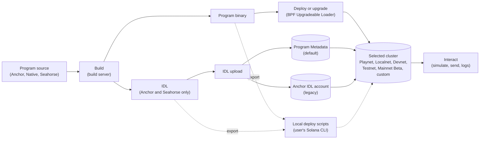
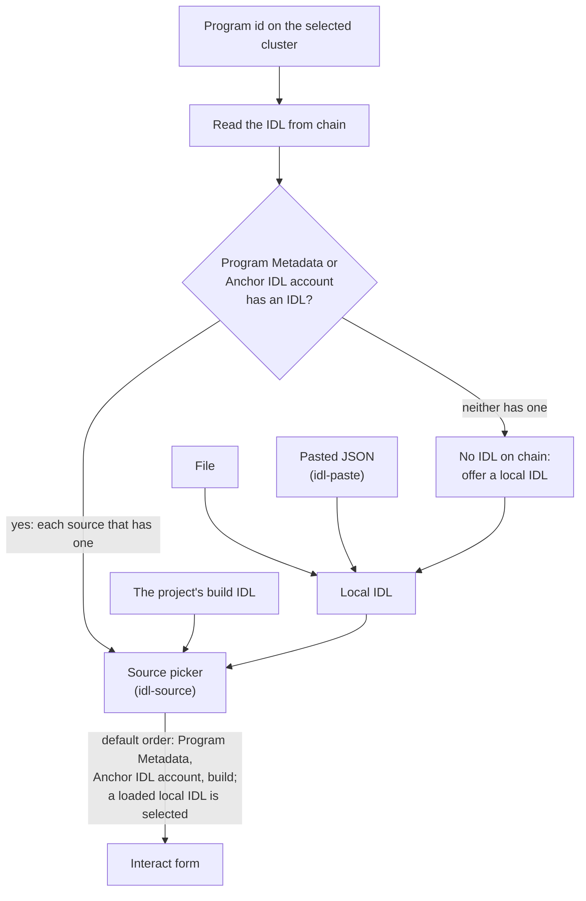
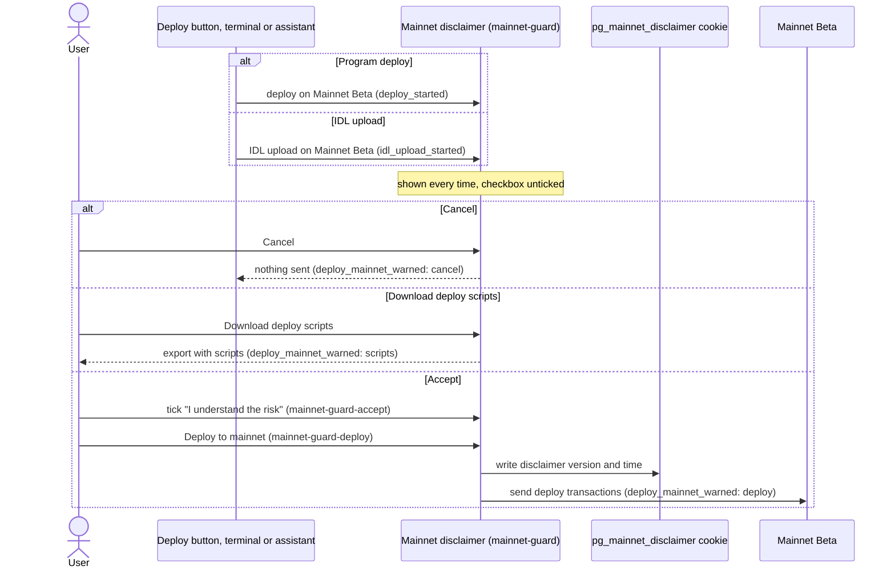

# Design

## Context

See [proposal.md](proposal.md), "Why". What client-v2 does in each step, read
at `dc22a4740`:

- **Build**: `commands/build/build.ts` writes the program keypair's public key
  into `declare_id!` and posts the source to the build server
  (`utils/server.ts`). The server returns `{ stderr, uuid, idl }`, keeps the
  binary and serves it to the deploy from `/deploy/{uuid}`.
  `utils/program-info.ts` keeps the IDL, the keypair and the uuid in
  `.workspace/program-info.json`, which project sync carries to other
  devices. Anchor is pinned to 0.29.
- **Deploy**: `commands/deploy/` runs the BPF Upgradeable Loader steps in the
  browser. The playground wallet (`utils/wallet/wallet.ts`, a keypair in
  localStorage) pays and signs. An extension wallet first transfers the cost
  to the playground wallet. Nothing warns before Mainnet Beta.
- **IDL**: nothing writes an IDL on chain from the UI. "Upload IDL" in
  `views/flow/stages/IdlActions.tsx` replaces the IDL in the browser only.
  `effects/fetch-idl/fetch-idl.ts` reads the Anchor IDL account, and only for
  the project's own deployed program.
- **Interact**: `views/flow/stages/Interact.tsx` embeds the upstream test form
  (`views/sidebar/test/`) over `utils/program-interaction/`. Accounts with a
  `pda` field get a From seed generator, and `pda.programId` is ignored.
- **Export**: `PgFramework.exportWorkspace` (`utils/framework.ts`) zips the
  framework layout with `target/deploy/<name>-keypair.json` and a README of
  `anchor build` and `anchor test`.

Solana Explorer's Interactive IDL (`app/features/idl/interactive-idl/` in
solana-explorer) is the reference for Interact. It reads Codama and Anchor
0.30+ only, takes the IDL from chain only (Program Metadata first, the Anchor
IDL account as a fallback), derives PDAs from IDL seeds, simulates before an
execute by default, and confirms the first execute on mainnet.

## Goals / Non-Goals

**Goals:**

- Every function in the four specs exists in client-v2, and the existing ones
  keep working while the gaps are filled.
- The flow on the playground matches the flow on a developer's machine:
  `anchor build`, `solana program deploy`, an IDL upload, a client call.

**Non-Goals:**

- Replacing the upstream test form in one step. It moves by the UI move rule
  in `client-v2/CLAUDE.md`, one part at a time.
- Changing the build server's API.

## Decisions

### Two outputs, one cluster per upload

A build produces a binary and an IDL from the same source. A deploy puts each
on one cluster, in separate transactions: first the binary, then the IDL. The
specs therefore track deploy and IDL state per cluster: a program on Devnet is
not on Mainnet Beta until it is uploaded there. This mirrors how Solana itself
works, and keeps the user from reading a Devnet IDL as proof of a mainnet
program.

### Program Metadata is the default IDL source, the Anchor IDL account is legacy

Both store an IDL for a program id, and the Explorer shows both. Program
Metadata is the program the ecosystem is moving to and the one the Explorer
reads first, so the playground uploads there by default and reads it first.
The Anchor IDL account stays available both for reading and for upload,
because programs deployed with older Anchor tooling publish only there.
Alternative considered: Anchor IDL account only, as `anchor idl init` does at
0.29. Rejected: an IDL there is not what the Explorer reads first, so a user
could publish and still see a stale IDL.

### A local IDL is a first-class source

A program may be deployed with no IDL published, often because other people
maintain it. The playground does not build an IDL for such a program. Instead
the user supplies one: a file, or JSON pasted or typed into an editor. Both
paths give the same result. A local IDL is also how the user tries an edited
copy of a published IDL. Loading one never writes to the chain.

### A mainnet deploy needs an explicit acceptance, every time

The playground wallet is a keypair in localStorage. Funding it for a mainnet
deploy means sending real SOL to a key any script on the page can read. The
playground cannot make that safe, so a mainnet deploy stays possible only
after the user accepts that risk, and the disclaimer recommends the
alternative: the same program, with the same program id, deployed from the
user's machine with the scripts in the export.

The disclaimer sits in front of the deploy itself, not in front of one
button, so the terminal `deploy` command and the assistant's tools reach it
too, and an extension wallet does not skip it: a deploy with an extension
still moves the cost into the playground wallet, which signs the loader
transactions. IDL uploads wait for it the same way. Sending an instruction
from Interact keeps its own confirmation: it calls a program, it does not
deploy one.

The acceptance is a checkbox in a dialog, not a tooltip: a tooltip opens on
hover, so it never appears on a phone or for a keyboard user, and it cannot
hold a required action. The checkbox starts unticked on every deploy, and a
stored acceptance never skips the dialog, because a remembered yes would let
a later deploy started by the assistant spend real SOL unasked.

The cookie `pg_mainnet_disclaimer` records that this browser accepted the
disclaimer, its version and when. It is a record kept by the playground, not
proof: the user can edit or clear it, and the server never sees who ticked
the box. The 182-day lifetime matches the Explorer's `idl_mainnet_accepted`
cookie and was chosen while writing this change.

TODO(ticket to file): store each acceptance on the server for a signed-in
user (account, disclaimer version, time), so the record can be checked
later; the cookie stays as the browser-side record.

Alternatives considered:

- Block mainnet deploys from the playground. Rejected: the user may have a
  reason to deploy from here, and the disclaimer plus the scripts leave the
  choice with them.
- Remember the acceptance and skip the dialog for a while, as the Explorer
  does. Rejected: the assistant and the terminal can start a deploy, and each
  mainnet deploy must have a click of its own.

The Interact confirmation on the first mainnet send per session follows the
Explorer's behaviour; it was chosen while writing this change, not requested. It is per
session rather than the Explorer's 182-day cookie, because the playground
wallet raises the stakes.

### Local deploy scripts live in the export

The export already carries the framework layout and the program keypair, so
it is the one place a user downloads to work locally. The scripts call the
Solana CLI and the Program Metadata CLI the user installs, with the cluster
and the payer keypair path as arguments, so no secret leaves the browser in
the zip except the program keypair, which is already there. Shell scripts were
chosen while writing this change; the request was only for scripts that
deploy the program and upload the IDL.

### Interact reads every format the playground reads

The Explorer gives no Interact form to an Anchor IDL older than 0.30. The
playground does, because its projects are built at Anchor 0.29 and the
upstream form handles that format today. Codama and Anchor 0.30+ are added
next to it. Automatic PDA derivation for 0.30+ seeds and for Codama
`pdaValueNode`s needs the Anchor 0.29 to 1.1.2 migration for projects built in
the playground; for a program read from the chain it does not.

### From seed stays

The Explorer derives PDAs from IDL seeds and has no manual builder. The
playground keeps From seed because many IDLs give no seeds, older Anchor IDLs
among them, and a user exploring someone else's program needs to build an
address by hand.

### Slices and telemetry

New code goes in four feature slices with their own prefixes: `program-build`
(`build`), `program-deploy` (`deploy`), `program-idl` (`idl`) and
`program-interact` (`interact`). A feature never imports another, so the
Flow stages, a widget, join them. The legacy `commands/build` and
`commands/deploy` stay where they are (the UI move rule keeps
`src/commands/` in place); the slices call them and emit the events. Events
carry no program id, address or signature, as `client-v2-telemetry` in
`telemetry-and-logging` requires, which is why they differ from the
Explorer's `iidl_*` events that carry `program_id`.

Every action control emits its own event, and an action that takes time also
emits an outcome event: `interact_send_started` on the click, `interact_sent`
or `interact_failed` on the result. With both, a funnel tells a user who never
clicked Send from one whose send failed, and a dialog's Cancel shows where a
user turned back. Instruction names stay out of the events because they come
from the user's IDL.

## Risks / Trade-offs

- [The Program Metadata program or its client changes format] → read and
  write through one client package, pinned, so a format change is one bump.
- [A user accepts the disclaimer and the browser key leaks] → the disclaimer
  names the risk and recommends the scripts; the playground cannot remove the
  risk while it signs with a browser key.
- [A deploy path skips the disclaimer] → the disclaimer guards the deploy
  itself, and the scenarios for the terminal and the assistant test it.
- [The cookie is cleared or edited] → it is a browser-side record only; the
  server record in the TODO above is what makes an acceptance checkable.
- [Two on-chain IDLs disagree] → the source picker shows which one is in use,
  and the default is the one the Explorer reads first.
- [The Anchor migration slips] → the 0.30+ and Codama tasks for projects built
  in the playground wait for it; reading such IDLs from chain does not.
- [Localnet needs a validator the playground does not start] → the Localnet
  scenario names `localhost:8899`; the export README says how to start
  `solana-test-validator`.

## Open Questions

- The exact name and version of the Program Metadata client package, settled
  by the IDL upload task.
