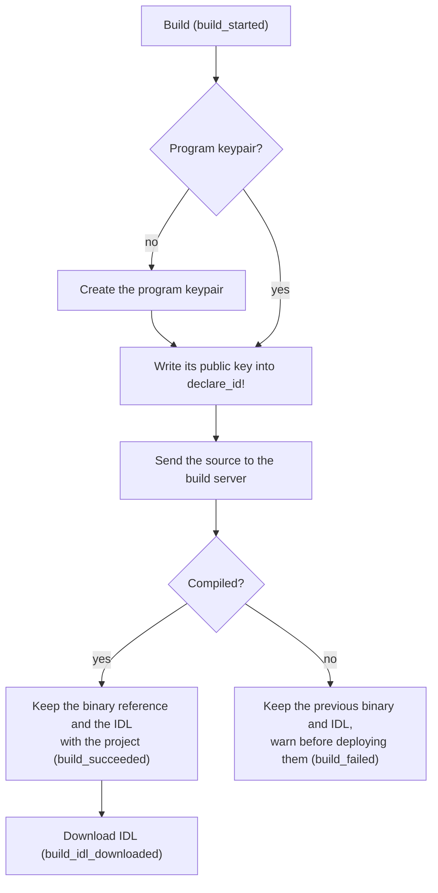

# Spec Delta

## Purpose

Turns a Solana program's Rust source into the two outputs a deploy needs, the
program binary and the IDL, and keeps both with the project until the next
build replaces them.

## ADDED Requirements

### Requirement: A build produces the program binary and the IDL

A build of an Anchor, Native or Seahorse project SHALL send the project's
source to the build server and, on success, SHALL keep a reference to the
program binary for the next deploy. For an Anchor or Seahorse project it SHALL
also keep the IDL the server generated from the same source. A Native project
produces no IDL.

#### Scenario: An Anchor project builds

- **WHEN** the user builds an Anchor project that compiles
- **THEN** the project holds a program binary ready to deploy
- **AND** the project holds the IDL generated from the same source

#### Scenario: A Native project builds

- **WHEN** the user builds a Native project that compiles
- **THEN** the project holds a program binary ready to deploy
- **AND** the project holds no IDL from this build

### Requirement: A build writes the program id into the source

Before it sends the source, a build SHALL set the program id in the source
(`declare_id!` for Anchor) to the public key of the project's program
keypair, and SHALL create a program keypair when the project has none.

#### Scenario: First build of a project without a keypair

- **WHEN** the user builds a project that has no program keypair
- **THEN** a program keypair is created and kept with the project
- **AND** the source sent to the server declares that keypair's public key

### Requirement: Build outputs survive a reload and follow the project

The IDL, the program keypair and the reference to the binary SHALL be stored
with the project, so a reload keeps them and a signed-in user sees them on
another device.

#### Scenario: Reload after a build

- **WHEN** the user builds a project and reloads the page
- **THEN** the project still has its IDL and can be deployed without a rebuild

### Requirement: A failed build keeps the previous outputs

A build that fails SHALL leave the previous binary and IDL in place and SHALL
say so before the user deploys them.

#### Scenario: Deploy after a failed build

- **WHEN** a build fails after an earlier one succeeded
- **AND** the user deploys
- **THEN** the playground warns that the binary is from the earlier build

### Requirement: The IDL can be downloaded

After a build that produced an IDL, the user SHALL be able to download it as a
JSON file from a Download IDL link under Build succeeded's Continue to Deploy
and Build again, shown only while the project holds an IDL (the build's or an
uploaded one); without one there is no Download IDL.

#### Scenario: Download the IDL

- **WHEN** the user downloads the IDL of a built Anchor project
- **THEN** a JSON file with the IDL from the latest build is saved

### Requirement: Build telemetry

The build SHALL emit `build_started { framework }` when a build is sent,
`build_succeeded { framework, has_idl }` when the compiler reports no error,
and `build_failed { framework, reason }` when it does not; the `build` command
sends all three (`funnel-events`, "Build events"), once per build. `framework` is
`anchor`, `native` or `seahorse`; `has_idl` is a boolean; `reason` is
`compile`, `server` or `network`.

#### Scenario: A compile error is tracked

- **WHEN** a build of an Anchor project fails with a compiler error
- **THEN** the memory provider records `build_failed` with
  `{ framework: "anchor", reason: "compile" }`

### Requirement: Every Build action emits an event

Every control on the Build screen that performs an action SHALL emit its own
event when used, separate from the outcome events: Build, and Build again on
Build succeeded, run the `build` command, whose `build_started` is their
event (the controls send no second one), Download IDL `build_idl_downloaded` and
Fix with assistant `build_fix_requested`, the last two with no parameters.
Continue to Deploy only switches the stage. A control without its event fails
review.

#### Scenario: Build again is tracked as a build

- **WHEN** the user picks Build again on Build succeeded
- **THEN** the memory provider records `build_started`

#### Scenario: Fix with assistant is tracked

- **WHEN** the user picks Fix with assistant on a diagnostic
- **THEN** the memory provider records `build_fix_requested` with `{}`
