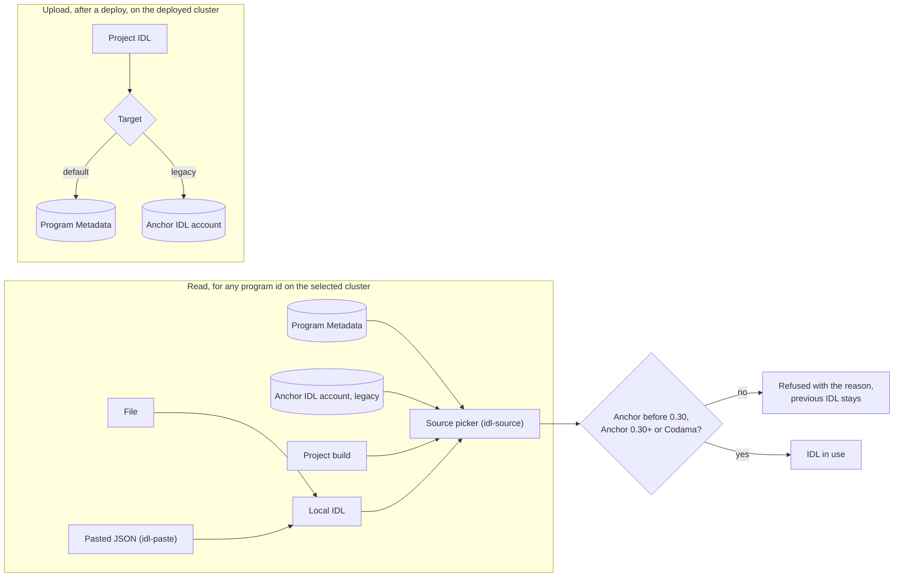

# Spec Delta

## Purpose

Says which IDL describes a program: one read from the chain, one from the
project's build, or one the user supplies, and how the playground publishes
the project's IDL on chain next to the program.

## ADDED Requirements

### Requirement: The playground reads three IDL formats

The playground SHALL read an Anchor IDL older than 0.30, an Anchor IDL of
0.30 or newer, and a Codama IDL, and SHALL say which format it read. An IDL in
none of these formats SHALL be refused with the reason, and the previous IDL
stays in use.

#### Scenario: A Codama IDL is read

- **WHEN** the user loads a Codama IDL
- **THEN** the IDL is accepted and shown as Codama

#### Scenario: Invalid JSON is refused

- **WHEN** the user pastes text that is not an IDL
- **THEN** the playground says why it was refused
- **AND** the IDL in use does not change

### Requirement: The IDL is read from the chain for any program id

For a program id on the selected cluster, the playground SHALL read the IDL
from the Program Metadata program and from the Anchor IDL account. This holds
for a program the user did not build. A program with neither SHALL stay usable
with a local IDL.

#### Scenario: A program with no IDL on chain

- **WHEN** the user opens a program id that has no IDL on either source
- **THEN** the playground says no IDL was found on chain
- **AND** offers to load a local IDL

### Requirement: The user picks the IDL source

When more than one IDL is available, the playground SHALL show the sources
(`data-testid="idl-source"`) and SHALL default to Program Metadata, then the
Anchor IDL account, then the project's build. The Anchor IDL account SHALL be
marked as the legacy source. A local IDL, once loaded, SHALL be selected.

#### Scenario: Both on-chain IDLs exist

- **WHEN** a program has an IDL in the Program Metadata program and in the
  Anchor IDL account
- **THEN** the Program Metadata IDL is selected
- **AND** the user can switch to the Anchor IDL account, marked legacy

### Requirement: A local IDL is loaded from a file or pasted

The user SHALL be able to load a local IDL by choosing a JSON file or by
pasting JSON into an editor (`data-testid="idl-paste"`). Both paths SHALL
give the same result. A local IDL applies to the selected program id on this
device and is never written to the chain by loading it.

#### Scenario: Paste an edited IDL

- **WHEN** the user pastes an edited copy of a published IDL
- **THEN** the Interact form is rebuilt from the pasted IDL
- **AND** nothing is sent to the chain

### Requirement: The project's IDL is uploaded on chain

After a deploy, the user SHALL be able to upload the project's IDL to the
cluster the program is deployed on, to the Program Metadata program by
default or to the Anchor IDL account. An upload SHALL replace an earlier IDL
at the same target and SHALL need the program's upgrade authority.

#### Scenario: Upload to Program Metadata

- **WHEN** the user uploads the IDL of a program deployed on Devnet
- **THEN** the IDL is written to the Program Metadata program on Devnet
- **AND** reading the program id on Devnet returns that IDL

#### Scenario: Upload by a wallet that is not the authority

- **WHEN** the wallet is not the program's upgrade authority
- **THEN** no transaction is sent and the required authority is named

### Requirement: An IDL upload is per cluster

An IDL uploaded on one cluster SHALL NOT be shown as uploaded on another. An
upload started on Mainnet Beta SHALL open the mainnet disclaimer and send
nothing until the user accepts it, as for a mainnet deploy.

#### Scenario: Devnet upload is not on mainnet

- **WHEN** the user uploads the IDL on Devnet and selects Mainnet Beta
- **THEN** the playground shows no IDL for the program on Mainnet Beta

#### Scenario: Mainnet upload opens the disclaimer

- **WHEN** the user uploads the IDL with Mainnet Beta selected
- **THEN** the mainnet disclaimer opens and no transaction is sent until the
  user accepts it

### Requirement: IDL telemetry

The IDL slice SHALL emit `idl_loaded { source, format }`,
`idl_load_failed { source, reason }`, `idl_uploaded { target, cluster }` and
`idl_upload_failed { target, cluster, reason }`. `source`: `metadata`,
`anchor`, `build`, `file`, `paste`; `format`: `anchor_legacy`, `anchor`,
`codama`; `target`: `metadata`, `anchor`; `reason`: `not_found`, `invalid`,
`rpc`, `authority`; `cluster` as in deploy.

#### Scenario: A pasted IDL is tracked

- **WHEN** the user pastes a valid Codama IDL
- **THEN** the memory provider records `idl_loaded` with
  `{ source: "paste", format: "codama" }`

### Requirement: Every IDL action emits an event

Every IDL control that performs an action SHALL emit its own event when
used, separate from the outcome events: the source picker
`idl_source_selected { source }`, Load IDL file `idl_file_picker_opened`,
Paste IDL `idl_paste_opened`, Clear local IDL `idl_local_cleared`, the upload
target choice `idl_target_selected { target }` and Upload
`idl_upload_started { target, cluster }`. Unlisted parameters are none.

#### Scenario: A file picker closed without a file

- **WHEN** the user opens Load IDL file and closes the picker
- **THEN** the memory provider records `idl_file_picker_opened` and no
  `idl_loaded`

#### Scenario: An upload is tracked from the click

- **WHEN** the user uploads the IDL to Program Metadata on Devnet
- **THEN** the memory provider records `idl_upload_started` with
  `{ target: "metadata", cluster: "devnet" }` before `idl_uploaded`
