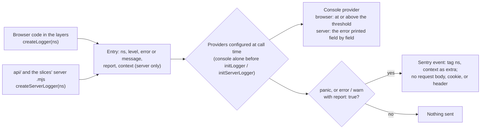

# client-v2-logging Specification

## Purpose
How code in `client-v2` logs, how each entry names its origin, which providers
receive it, and which entries reach Sentry, so that a failure in a user's
browser or in an `api/` function reaches the team with enough context to find
its source.

## Requirements

### Requirement: Every entry has a namespace

Every log entry SHALL carry a namespace of the form `<slice>:<module>`. An
entry from `Logger` without an `ns` option SHALL carry `app:common`; an entry
with an `ns` option SHALL carry that value; an entry from a logger made by
`createLogger(ns)` or `createServerLogger(ns)` SHALL carry `ns` unless the
call overrides it.

#### Scenario: The default namespace

- **WHEN** `Logger.warn("clipboard unavailable")` is called
- **THEN** the memory provider records namespace `app:common`

#### Scenario: A per-call namespace

- **WHEN** `Logger.error(error, { ns: "wallet:connect" })` is called
- **THEN** the memory provider records namespace `wallet:connect`

#### Scenario: A bound logger

- **WHEN** `createLogger("persistence:sync").error(error)` is called
- **THEN** the memory provider records namespace `persistence:sync`

#### Scenario: Console output

- **WHEN** the console provider receives an entry with namespace
  `persistence:sync`
- **THEN** the printed line starts with `[persistence:sync]`

### Requirement: Providers configured later receive entries from loggers created earlier

The browser logger and the server logger SHALL each send an entry to the
providers configured at the time of the call, not at the time the logger was
created.

#### Scenario: A module-level logger and a later initLogger

- **WHEN** a logger is created at module import, `initLogger` is then called
  with the memory provider, and the logger logs an error
- **THEN** the memory provider receives the entry

### Requirement: Console is the default provider

Before `initLogger`, or `initServerLogger` on the server, is called, entries
SHALL go to that logger's console provider, and each SHALL replace the
provider list with the one it is given. The browser console provider SHALL
map `panic` and `error` to `console.error`, `warn` to `console.warn`, `info`
to `console.info`, and `debug` to `console.debug`, and SHALL print only
entries at or above its threshold: `debug` in development, `warn` in
production, or the level in `REACT_APP_LOG_LEVEL` when set. The server
console provider SHALL print an error as a plain object of its own
properties, `message`, `code`, `stack`, and `cause`, and `context` after it.

#### Scenario: An error during start-up

- **WHEN** an error is logged before `initLogger` runs
- **THEN** it is printed with `console.error`

#### Scenario: Production threshold

- **WHEN** a production build logs at `info` and at `warn` with
  `REACT_APP_LOG_LEVEL` unset
- **THEN** only the `warn` entry is printed

#### Scenario: The app's configuration

- **WHEN** the app starts
- **THEN** `initLogger` is called once, by the `Observability` widget, with
  the console and Sentry providers

#### Scenario: A driver error in a route

- **WHEN** `api/projects.mjs` catches a database error that carries `code`
  and `constraint`, and logs it
- **THEN** the function log shows `[api:projects]` and the error's
  `message`, `code`, `constraint`, `stack`, and `cause`

### Requirement: Reported entries reach Sentry through one provider per logger

The browser logger SHALL reach Sentry only through
`shared/lib/logger/providers/sentry.ts`, and the server logger only through
`sentryServerProvider` in `shared/lib/logger/server.mjs`, which takes the
loaded SDK as an argument so that `shared/lib/logger` never imports
`@sentry/node`. No other file under `shared/lib/logger/providers/` SHALL
import `@sentry/*` statically. Each provider SHALL send every `error` or
`warn` entry logged with `report: true`, the browser's every `panic` entry
too, and no `info` or `debug` entry, as an event, with the tag `ns` set to the
entry's namespace and, on the server, `context` as the event's `extra`. The browser
provider SHALL do nothing when `REACT_APP_SENTRY_DSN` is unset; in the
browser, an entry at `warn` or above that is not reported reaches Sentry only
as a breadcrumb, which no report is sent for.
`withObservability` SHALL register the server provider only once
`@sentry/node` has loaded, and SHALL initialise `@sentry/node` so that no
event carries a request body, a cookie, or a request header.

#### Scenario: A Sentry import in another logger provider

- **WHEN** a file under `shared/lib/logger/providers/` other than the Sentry
  provider has a static import of `@sentry/react`
- **THEN** `yarn lint` fails

#### Scenario: An error not marked for reporting (manual)

- **WHEN** `Logger.error(error)` is called without `report: true`
- **THEN** the Sentry provider sends no event, and keeps the entry as a
  breadcrumb for the next report

#### Scenario: A reported error

- **WHEN** `createLogger("persistence:sync").error(error, { report: true })`
  is called with a DSN configured
- **THEN** Sentry receives an exception event at level `error` with tag
  `ns: persistence:sync`, the build's release, and its environment

#### Scenario: No DSN

- **WHEN** a build without `REACT_APP_SENTRY_DSN` logs a panic
- **THEN** nothing is sent and nothing throws

#### Scenario: A reported server error with Sentry on

- **WHEN** Sentry is on and a handler wrapped by `withObservability` calls
  `createServerLogger("api:projects").error(error, { report: true, context: { code: "23505" } })`
- **THEN** Sentry receives the exception with the tag `ns: api:projects` and
  `extra` `{ code: "23505" }`

#### Scenario: A request's body, cookies and headers

- **WHEN** Sentry is on and an error is captured while a function handles a
  request with a body, a session cookie, and an `authorization` header
- **THEN** the event Sentry receives holds none of them

### Requirement: Unhandled and render errors go through the logger

The logger SHALL log with `Logger.panic` every uncaught error, unhandled
promise rejection, and error thrown while rendering, and Sentry SHALL NOT
capture them through any other path. There are two exceptions. The
browser's `ResizeObserver loop completed with undelivered notifications.`
error event, which carries no `error`, is dropped before it is logged; an
event with any other message, or with an `error`, is logged (HOO-2125). A
rejection the terminal has already printed for the user (its "Process error"
line, or the line a stop prints) is marked as shown and logged at `warn`, a
breadcrumb only (HOO-1800); an unmarked rejection is a `panic`. Only an
object can be marked: a thrown string or other primitive stays a `panic`
even when the terminal printed it.

#### Scenario: An unhandled rejection (manual)

- **WHEN** a promise rejects, nothing handles it, and the terminal has not
  printed it
- **THEN** the memory provider records a `panic` entry with namespace
  `logger:global`, and Sentry receives exactly one event for it, marked
  unhandled

#### Scenario: The browser's ResizeObserver loop notice (manual)

- **WHEN** a fresh load of the development server lays out the panels and the
  browser reports `ResizeObserver loop completed with undelivered
  notifications.`
- **THEN** the console shows no `logger:global` entry for it (C-4 in
  `docs/testing.md`)

#### Scenario: A terminal command fails as expected (manual)

- **WHEN** a terminal command fails with an `Error` in a way the user is shown
  (an unknown command, a declined wallet question, any "Process error" line, a
  stop) and the rejection reaches the global handler
- **THEN** the memory provider records a `warn` entry with namespace
  `logger:global`, not reported, and Sentry receives no event for it

#### Scenario: A component throws while rendering

- **WHEN** a component under the root `LoggerErrorBoundary` throws during
  render
- **THEN** the memory provider records a `panic` entry with namespace
  `app:render`, and the boundary renders its fallback

### Requirement: A thrown value that is not an Error keeps its value

When an entry is logged with a value that is not an `Error`, the logger SHALL
create an `Error` whose message is the value converted to a string and whose
`cause` is the original value.

#### Scenario: A string is thrown

- **WHEN** `Logger.error("timeout")` is called with a string as the error
- **THEN** the recorded entry's error is an `Error` with message `timeout`
  and `cause` `"timeout"`

### Requirement: Code in the layers logs through the logger

Code under `src/{features,shared,entities,widgets}/` and `api/` SHALL NOT
call `console.*`, except the browser console provider
`shared/lib/logger/providers/console.ts`, the server console provider
`shared/lib/logger/providers/server-console.mjs`, and test files. Browser
code logs through `shared/lib/logger`; `api/` and the slices' `.mjs` server
modules log through `createServerLogger(ns)` in
`shared/lib/logger/server.mjs`, which takes the levels `error`, `warn`,
`info` and `debug`, the `ns` and `report` options of the browser logger, and
a `context` record that describes the failure. A `catch` in those layers and
in `api/` SHALL rethrow, log through a logger, or show the failure to the
user.

#### Scenario: A console call in a feature

- **WHEN** a file under `features/` calls `console.error`
- **THEN** `yarn lint` fails

#### Scenario: A console call in a route

- **WHEN** a file under `api/` calls `console.error`
- **THEN** `yarn lint` fails

#### Scenario: Output of the user's code

- **WHEN** a legacy root such as `utils/js-runtime` or a `.raw` template
  calls `console.log` for the user's program
- **THEN** the lint rule does not apply

### Requirement: Stack traces in Sentry are readable and source maps are private

Each production build SHALL upload its source maps to Sentry under a release
named after the commit SHA, and SHALL NOT deploy the `.map` files.

#### Scenario: An error from production

- **WHEN** Sentry receives an error from a production build
- **THEN** its stack trace shows original file names and lines

#### Scenario: Requesting a source map

- **WHEN** a browser requests `/static/js/<bundle>.js.map` from the deployed
  site
- **THEN** the response is not the source map

### Requirement: Reports carry no user code or secret key

An error event the browser sends to Sentry SHALL NOT carry the user's program
output or a secret key. Sentry's `Console` integration SHALL be off and every
`console` breadcrumb dropped; the logger's own trail SHALL reach Sentry as
breadcrumbs the reporter adds, one per entry at `warn` or above. In every
value of an error event and of a breadcrumb, a hex or base58 run of 64 or more
characters, a list of 32 or more numbers from 0 to 255 (bracketed, bare,
or as an index-keyed object), and a typed array of 32 or more bytes, SHALL be
replaced with `[redacted]`, in keys as in values.
An event that cannot be scrubbed SHALL be replaced by one that says it was
withheld. Public keys (32 to 44 base58 characters) SHALL be kept. A feedback
SHALL be sent as the user wrote it: it is text they chose to send. The
scenarios below are automated by `reporter/sentry.integration.test.ts`, which
runs the real SDK, and checked by hand on a preview with a DSN.

#### Scenario: The user's test prints to the console (manual)

- **WHEN** a test the user runs prints a value with `console.log`, even one
  that starts with a `[slice:module]` tag, and an error is reported afterwards
- **THEN** the report's breadcrumbs do not include that output

#### Scenario: A secret key in an error message (manual)

- **WHEN** a reported error's message quotes a 64-byte secret key, as base58
  or as a JSON byte array
- **THEN** the report shows `[redacted]` in its place

#### Scenario: A secret key in a reported context (manual)

- **WHEN** a reported entry's context holds a secret key as a `Uint8Array`
- **THEN** the report shows `[redacted]` in its place

#### Scenario: A wallet address in a reported context (manual)

- **WHEN** a reported entry's context holds a wallet's public key
- **THEN** the report shows the public key as it was
